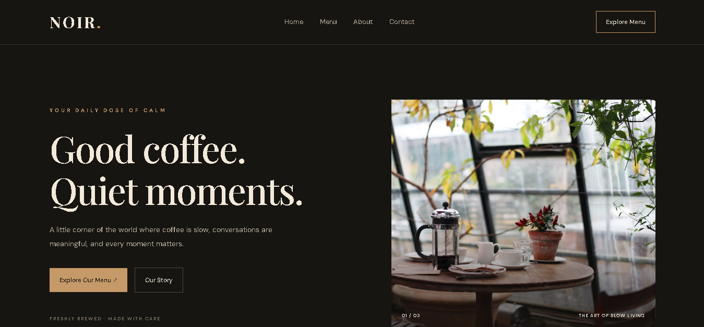

# ☕ NOIR Café Website

A modern, stylish, multi-page café website built using HTML, CSS and JavaScript.

## 🌐 Live Demo

[Visit NOIR Café Website](https://leafy-buttercream-5ee09f.netlify.app/)

## 📸 Website Preview

## 📌 About the Project

NOIR Café is a website project created to practise frontend web development and build a digital presence for a café.

## ✨ Features

- Home page
- About section
- Menu section
- Contact section
- Interactive elements using JavaScript
- Clean and modern design

## 🛠️ Technologies Used

- HTML5
- CSS3
- JavaScript

## 📂 Project Structure

- index.html – Main webpage
- style.css – Website styling
- script.js – JavaScript functionality

## 🎯 Purpose

Created as a practical web development project to improve frontend development skills.

---

**Developed by Pranjal Shikha**
